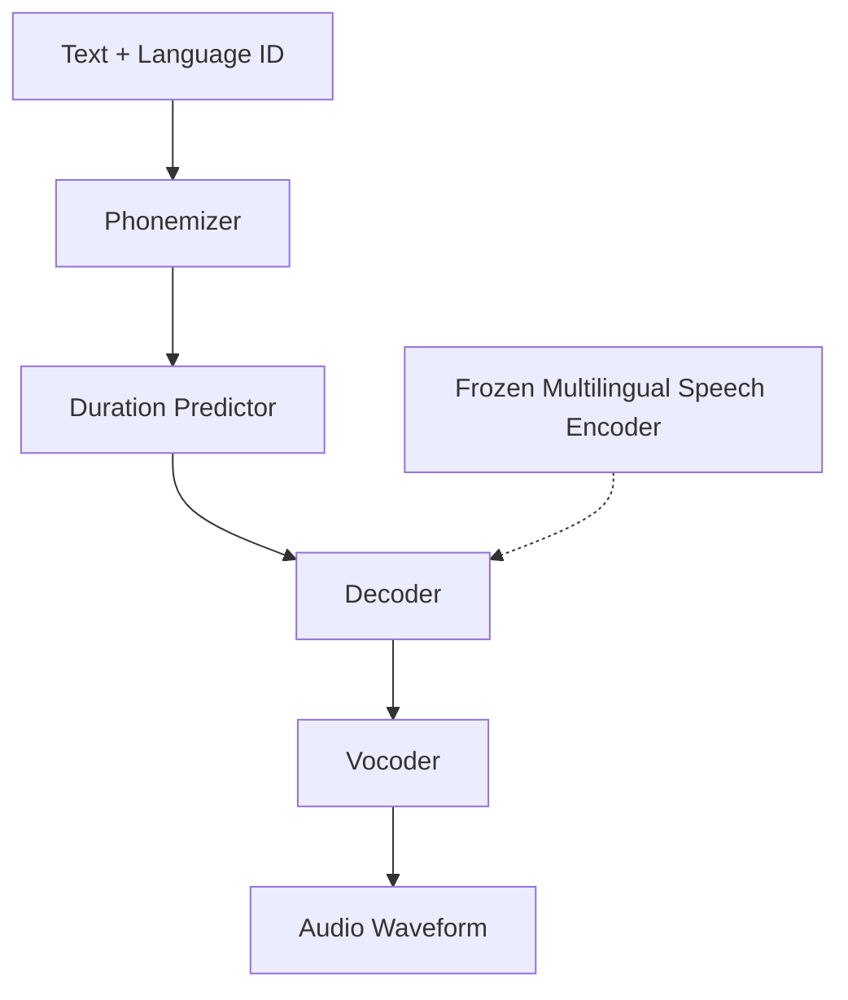
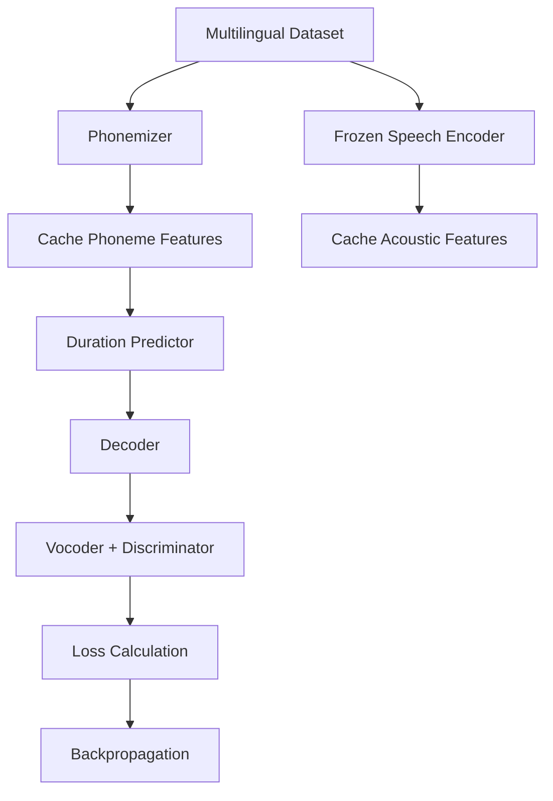
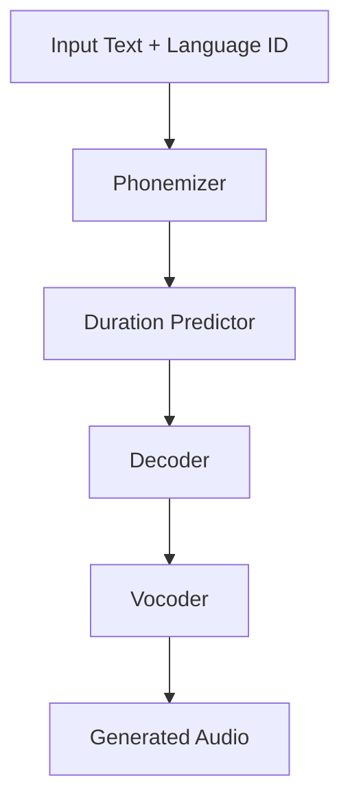

# Multilingual Text-to-Speech (TTS)

A from-scratch multilingual Text-to-Speech system designed to generate natural-sounding speech across 6–10 languages using a single consumer GPU (NVIDIA RTX 3060, 12GB VRAM).

## 🚀 Project Overview

This project proposes a multilingual TTS system that converts written text into natural human-like speech.

The architecture is designed to:
- Support 6–10 languages from different language families.
- Generate natural-sounding speech rather than robotic audio.
- Train on a single GPU with 12GB VRAM.
- Train the generative model from scratch.
- Use a shared multilingual architecture instead of separate models for each language.

## 🎯 Key Features

- Multilingual text-to-speech generation.
- Duration-based non-autoregressive architecture.
- Stochastic duration prediction for natural speech timing.
- Shared language-conditioned model.
- Training-time frozen multilingual speech encoder.
- Lightweight inference pipeline.
- Single-GPU training design.

## 🏗️ Proposed Architecture

The project uses a duration-based, non-autoregressive architecture inspired by the VITS family.

### Components

| Component | Training Status | Purpose |
|---|---|---|
| Phonemizer | Pretrained / Off-the-shelf | Converts text into phonemes |
| Multilingual Speech Encoder | Frozen | Extracts acoustic-linguistic features |
| Duration Predictor | Trained from scratch | Predicts natural speech timing |
| Decoder | Trained from scratch | Converts phonemes and durations into acoustic features |
| Vocoder | Trained from scratch | Generates audio waveforms |
| Discriminator | Trained from scratch | Helps improve audio realism |

## 🔄 Training Workflow

### Training Techniques

- **Teacher Forcing:** Uses ground-truth durations during decoder training.
- **Reconstruction Loss:** Compares generated acoustic features with real features.
- **Adversarial Loss:** Encourages realistic speech generation.
- **Duration Loss:** Measures the difference between predicted and actual phoneme durations.
- **Feature Caching:** Stores frozen encoder outputs to reduce repeated computation.

## 📚 Dataset Plan

The following datasets are proposed for multilingual training.

| Dataset | Language Coverage | Purpose |
|---|---|---|
| FLEURS | Approximately 102 languages | Multilingual speech diversity |
| Mozilla Common Voice | 100+ languages | Crowd-sourced speech recordings |
| CSS10 | 10 languages | Clean single-speaker TTS data |
| VoxPopuli | 15+ European languages | Parliamentary recordings |
| Multilingual LibriSpeech | 8 languages | Audiobook speech data |

The goal is to select 6–10 languages with different linguistic characteristics.

### Dataset Links

- [FLEURS](https://huggingface.co/datasets/google/fleurs)
- [Mozilla Common Voice](https://commonvoice.mozilla.org/)
- [CSS10](https://github.com/Kyubyong/css10)
- [VoxPopuli](https://github.com/facebookresearch/voxpopuli)
- [Multilingual LibriSpeech](https://www.openslr.org/94/)

## 🎙️ Inference Workflow

During inference, the system does not require the frozen multilingual speech encoder.

This makes the inference pipeline lightweight and independent of the large pretrained speech encoder.

## ⚖️ Why This Architecture?

| Factor | Diffusion Models | Autoregressive Transformers | Proposed Architecture |
|---|---|---|---|
| Inference Speed | Slower | Sequential generation | Fast |
| Training Data | High | High | Moderate |
| GPU Memory | High | High | Lower by design |
| Single-GPU Training | Challenging | Challenging | More practical |

The duration-based non-autoregressive architecture is selected because it is more suitable for the project's limited hardware and data constraints.

## 📊 Evaluation Plan

The system will be evaluated using the following metrics:

| Metric | Tool | Purpose |
|---|---|---|
| Speech Quality | UTMOS | Estimates perceptual speech quality |
| Intelligibility | Whisper | Measures transcription accuracy |
| Word Error Rate | WER | Compares generated speech transcription with original text |
| Model Efficiency | Parameter Count | Measures model size |
| Training Efficiency | GPU Training Time | Measures computational requirements |

## 💻 Hardware Requirements

| Component | Specification |
|---|---|
| GPU | NVIDIA RTX 3060 |
| GPU Memory | 12GB VRAM |
| Architecture | Duration-based Non-autoregressive |
| Training | From Scratch |
| Target Languages | 6–10 |

## 📌 Project Development Roadmap

- [ ] Finalize target languages.
- [ ] Collect multilingual datasets.
- [ ] Prepare and preprocess audio and text.
- [ ] Implement phonemization.
- [ ] Perform forced alignment.
- [ ] Extract frozen encoder features.
- [ ] Implement duration predictor.
- [ ] Implement decoder.
- [ ] Implement vocoder and discriminator.
- [ ] Train the model.
- [ ] Evaluate speech quality and intelligibility.
- [ ] Optimize inference performance.

## 🔮 Future Improvements

- Increase the number of supported languages.
- Improve speech naturalness and pronunciation.
- Optimize inference speed.
- Improve multilingual voice consistency.
- Explore speaker conditioning and voice diversity.

## 🏁 Conclusion

This project aims to develop a multilingual Text-to-Speech system that generates natural-sounding speech while operating within a limited computational budget.

By combining a frozen multilingual speech encoder for training-time feature extraction with a duration-based non-autoregressive architecture, the proposed system targets multilingual speech generation using a single consumer GPU.

The ultimate goal is to explore how effectively a multilingual TTS model can be trained from scratch under practical hardware constraints.

## 📖 References

- [FLEURS Dataset](https://huggingface.co/datasets/google/fleurs)
- [Mozilla Common Voice](https://commonvoice.mozilla.org/)
- [VITS Architecture](https://github.com/jaywalnut310/vits)
- [Whisper](https://github.com/openai/whisper)
- [UTMOS](https://github.com/sarulab-speech/UTMOS22)
